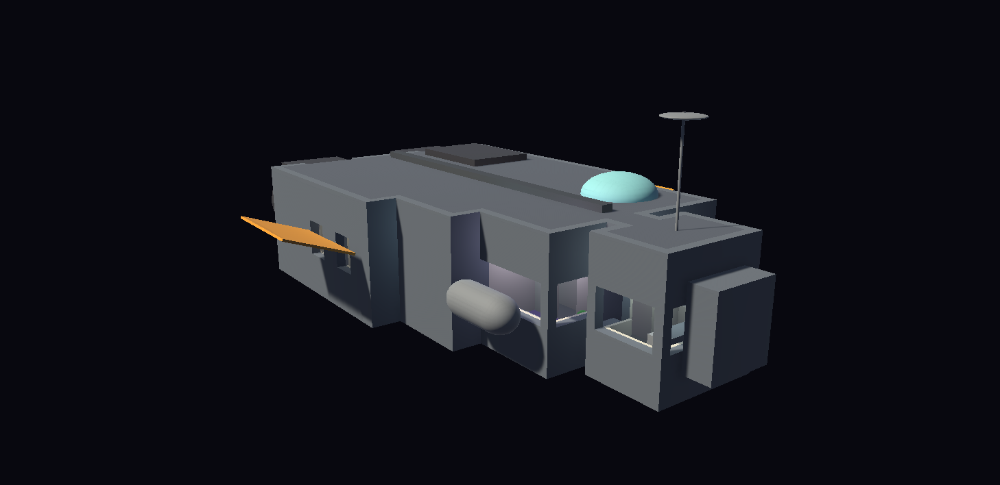
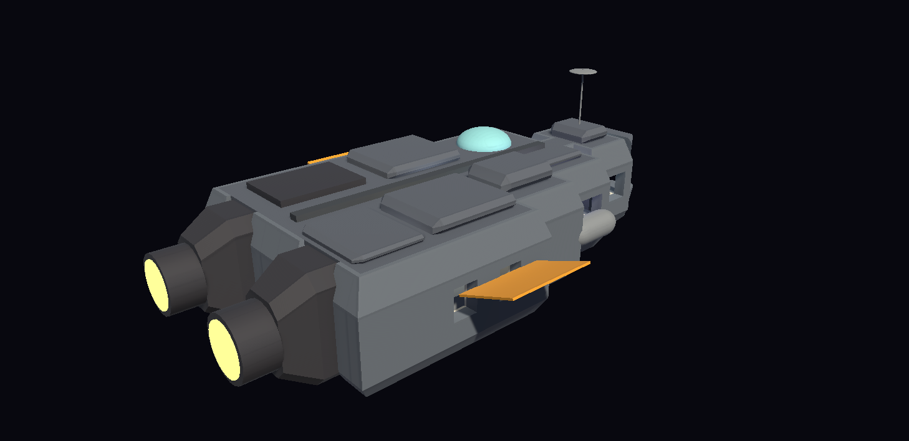
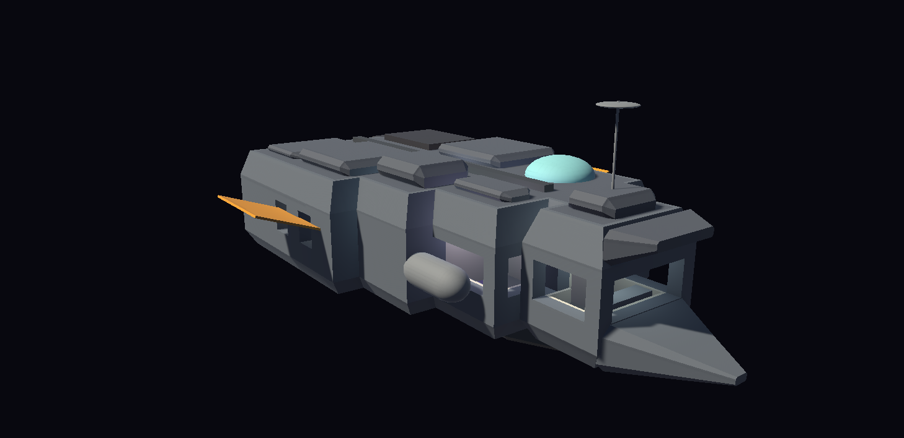
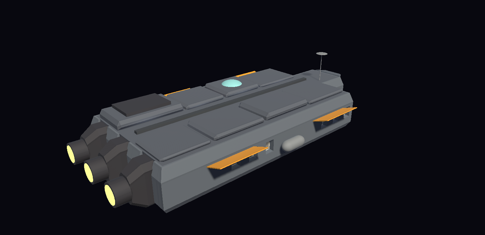
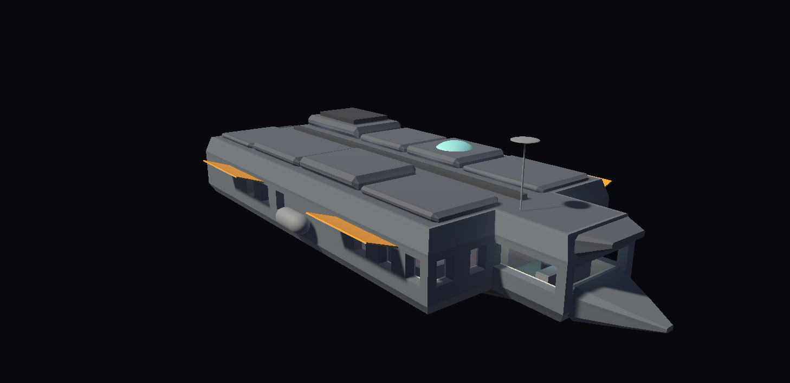
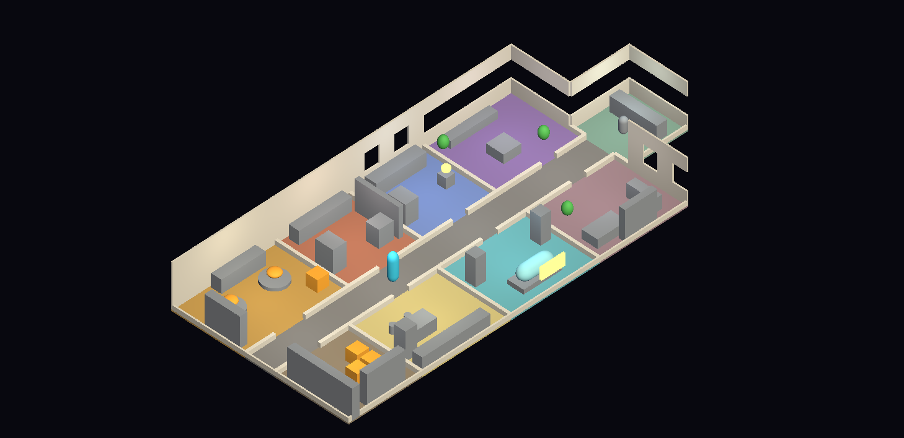
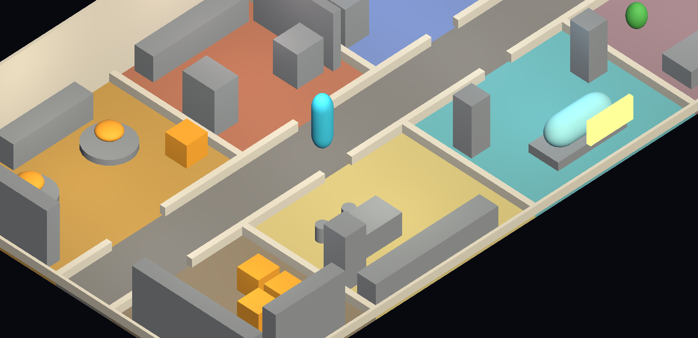

# 우주선 제작 설계안: 격자 규칙 + 3D 표현

작성일 2026-11-23. 구현 전 설계 문서이며, 여기 적힌 수치는 프로토타입에서 확인하고 고칠 출발값이다.

## 0. 요약

- **격자**: 한 칸은 가로세로 1m(0.1절에서 확정. 본문의 처음 제안은 2m였다), 한 층 높이는 4m(방 안 높이 3m + 층 사이 1m)로 잡는다. 좌표는 처음부터 층까지 포함한 3차원 정수로 저장한다.
- **모듈**: 방 하나가 프리팹 하나다. 프리팹에는 바닥, 붙박이 설비, 가구 자리, 수리 지점, 조명만 넣는다. 벽, 지붕, 외피는 프리팹에 넣지 않고 격자를 보고 자동으로 붙인다.
- **외피**: 칸의 여섯 면을 하나씩 검사해서 조각을 붙이는 "면 단위 조각 키트" 방식을 추천한다. 벽은 안쪽 벽과 바깥 외피의 두 겹으로 만든다.
- **두 가지 뷰**: 내부 뷰는 화각이 아주 좁은 원근 카메라(멀리서 망원으로 보는 것이라 눈으로는 원근 없는 그림과 거의 같다), 외부 뷰는 일반 원근 궤도 카메라다. 둘 다 원근 카메라라서 Cinemachine이 부드럽게 이어 준다.
- **셰이더 하나**: 우주선의 모든 표면이 Shader Graph로 만든 셰이더 하나를 쓴다. 이 셰이더가 벽 자르기, 지붕 사라지기, 부식, 시대 색을 모두 맡는다.
- **손상**: 부식의 진행은 셰이더 값으로(에셋 추가 없음), 고장 난 지점은 데칼과 이펙트로, 구멍이 뚫린 상태만 메시 교체로 표현한다.
- **시대**: 모듈은 태어난 시대의 모습을 그대로 유지한다. 시대마다 만드는 것은 "외피 키트 한 벌 + 무늬 텍스처 한 장 + 색 설정"뿐이라 에셋이 곱으로 늘지 않는다.
- **조명**: 배치를 게임 중에 바꾸므로 조명은 전부 실시간이다. 별빛은 방향광 하나와 "별빛 프로필" 데이터로 시대마다 바꾸고, 실내등은 방마다 렌더링 레이어를 달리해서 옆방으로 새지 않게 한다.
- **첫 프로토타입**: 회색 상자 조각으로 모듈 세 개를 끼우고 두 뷰를 전환하는 데까지 약 2주로 본다.

## 0.1 결정 사항 (2026-11-23 사용자 확정)

아래 결정은 본문보다 우선한다. 본문의 2m 기준 수치(벽 조각 길이, 문 폭, 모듈 크기 표)는 이 결정에 맞춰 읽는다.

| 항목 | 결정 |
|---|---|
| 칸 크기 | **가로세로 1m.** 사람 한 명이 가로세로 한 칸, 높이 두 칸을 차지한다. 방 안 높이는 3칸(3m), 층 높이는 4m 그대로다. 문은 폭 1칸, 높이 2칸이다 |
| 모듈 크기 | 1m 칸의 배수. 표준 방은 3×3~4×4칸, 큰 방은 4×5~5×4칸, 복도는 폭 1칸이다. 벽과 외피 조각의 길이도 1m가 된다 |
| 외피 수리 | **드론에게 시킨다.** 플레이어는 실내 설비를 직접 고치고, 외피는 드론에게 우선순위를 지시한다. 5.3절의 "안쪽 벽 앞 수리 지점"은 쓰지 않고, 안쪽 벽의 부식 표시는 "어디를 드론에게 시킬지" 알려 주는 용도로 남긴다 |
| 그림체 | 깎은 중간 폴리곤 + 트림 시트 |
| 플랫폼 | PC만. 모바일용 렌더 설정은 쓰지 않는다 |
| 엔진 등 외부 설비 | 격자 칸을 차지하는 모듈이다. 엔진 하나가 2×2칸(4칸)이다. 안테나, 방열판 같은 작은 것은 부착물로 둔다 |
| 문 | 자동으로 위치가 정해지고 자동으로 열린다. 문이 고장 나면 고칠 때까지 그 문으로 지나갈 수 없다 |
| 시대 | 미정. 3000년부터 1조 년까지를 전부 디자인하지 않는다. 6장의 구조(모듈은 태어난 시대 유지, 시대당 키트 한 벌)만 지키고, 우선 1시대 한 벌만 만든다. 시대 수는 키트를 한 벌 만들어 본 뒤 공수를 보고 정한다 |
| 내부 카메라 90도 회전 | 아직 미정 |

칸을 1m로 줄이면 벽 조각 수는 늘지만 같은 조각을 반복해 쓰는 것이라 제작 공수는 그대로다. 달라지는 것은 가구가 여러 칸을 차지하게 된다는 점뿐이고, 나중에 칸 단위 건설로 넘어가기는 오히려 쉬워진다.

### 회색 상자 시안

`Assets/Scenes/ShipBlockout.unity`에 1m 칸 기준의 시안을 Unity 기본 도형으로 만들었다. 방 9개(복도, 드론 격납고, 작업실, 연구실, 저장고, 부엌, 동면실, 창가, 함교)와 엔진 2개이고, 전체가 약 20m×11m다. `Ship_Blockout` 아래의 그룹을 켜고 끄면 두 뷰를 볼 수 있다.

- 외부 뷰: `Exterior`와 `InnerWalls_NearFull`을 켜고 `InnerWalls_NearStub`을 끈다 (저장된 상태).
- 내부 뷰: `Exterior`와 `InnerWalls_NearFull`을 끄고 `InnerWalls_NearStub`을 켠다.





**윤곽 다듬기(2차 시안)**: 외피를 ProBuilder 메시로 바꿨다. 바깥 벽은 밑이 깎이고 윗선이 비스듬히 꺾이는 단면으로 한 칸마다 한 조각씩 만들었고, 볼록 모서리는 세 단면을 이은 조각이다. 엔진은 팔각 단면으로 좁아지는 몸통, 선수는 뾰족한 뱃머리와 함교 차양, 밑에는 용골, 지붕에는 방마다 높이가 다른 깎은 덮개를 얹었다. 1차의 네모 덩어리보다 확실히 배처럼 읽힌다. 이 단면(밑 깎기 + 윗선 꺾기)이 곧 3.3절의 "바깥 직선 벽" 조각의 모양이다.




시안에서 확인한 것 두 가지:

- **방 사이 벽은 전부 낮춰야 한다.** 카메라 쪽 벽만 낮추면 앞쪽 방의 뒷벽이 복도와 뒤쪽 방을 가린다. 3.5절의 규칙을 "방과 방 사이의 벽은 양쪽 겹 모두 낮게, 온전한 높이로 남는 것은 카메라 반대쪽 외벽뿐"으로 고친다.
- **외형이 상자 같다.** 9장에서 예상한 위험이 그대로 보인다. 부착물 몇 개로는 부족하고, 외피 조각 자체의 윤곽(윗선 깎기, 모듈별 높이 차이, 뱃머리 형태)을 Blender 조각에서 해결해야 한다.

## 0.2 구획 나누기, 붙여 확장하기, 함체 크기 (FTL 스크린샷 참고)

### 구획은 칸에 방 번호를 매기는 것으로 나눈다

FTL의 배는 칸 격자 위에 "이 칸은 몇 번 방이다"를 적어 둔 것이다. 이 설계도 같은 구조다. 세이브에는 방마다 칸 좌표 목록만 저장하고(2.2절), 벽은 방 번호가 서로 다른 두 칸 사이의 변에 자동으로 생긴다(3.2절). 그래서 구획을 나누는 것은 "한 방의 칸 목록을 둘로 쪼개 새 번호를 준다"는 데이터 변경 하나이고, 벽과 문 틀은 생성기가 알아서 다시 만든다.

다만 모듈 프리팹은 붙박이 설비(동면 포드 등)와 가구 자리가 방 모양에 맞춰져 있어서 쪼갤 수 없다. 그래서 방을 두 종류로 둔다.

| 종류 | 설명 | 나누기 |
|---|---|---|
| 기능 모듈 | 동면실, 부엌, 격납고처럼 붙박이가 있는 방 | 나눌 수 없다. 통째로 옮기거나 철거만 |
| **빈 구획** (추천 추가) | 바닥과 외피만 있는 N×M칸 빈 방. 나중에 칸 단위 건설의 씨앗이 된다 | 칸 단위로 쪼개고 칸막이 벽을 칠 수 있다. 쪼갠 방마다 가구를 놓는다 |

빈 구획 덕분에 FTL처럼 "방을 나눠 쓰는" 꾸미기가 가능하고, 칸 단위 자유 건설은 이 위에 기능을 얹는 식으로 나중에 자연스럽게 넣는다.

### 더 붙이기

확장은 기존 칸에 변이 맞닿는 자리에만 놓을 수 있게 한다. 규칙은 세 가지다. 칸이 겹치지 않을 것, 배 전체가 문으로 이어져 있을 것, 새 모듈과 기존 방 사이에 문이 하나 이상 생길 것. 모듈은 1m 격자에 맞춰 90도 단위로 돌려 붙이고, 외피는 붙이는 순간 생성기가 다시 만든다. 그래서 배를 키우는 것(함체 확장)은 새 모듈을 사다 붙이는 한 가지 동작이다.

### 함체 크기

스크린샷의 Kestrel을 칸으로 어림하면 핵심부가 가로 14칸 안팎, 세로 6~7칸이고 방은 2×2~2×3칸이다. 지금 시안은 방 9개에 방 칸이 약 111칸, 엔진 포함 약 21×11칸이라 칸 수로는 이미 Kestrel의 두 배쯤이다. 그런데 좁게 느껴진다면 칸 수보다 이런 이유일 것이다.

- 복도 폭이 1칸이라 캐릭터와 가구가 걸린다. FTL은 캐릭터 한 명이 한 칸을 꽉 채우지만, 시안의 캡슐은 폭 0.5m라 얇다.
- 가구와 설비가 방 칸의 큰 부분을 차지한다. 사람이 돌아다닐 자리가 부족하다.
- WASD로 자유롭게 걷는 게임은 FTL처럼 칸에서 칸으로 점프하지 않아서 같은 칸 수라도 더 좁게 느낀다.

권장하는 기준은 이렇다. 복도는 2칸 폭, 기능 방은 최소 4×4칸, 큰 방(격납고, 작업실)은 6×6칸 안팎, 배 전체는 방 칸 약 200~250칸(엔진 포함 가로 30칸 안팎)이다. 칸 크기를 키우는 것(1m를 1.5m로)은 권하지 않는다. 문 폭과 조각 규격이 다 흔들리고, 칸 수를 늘리는 쪽이 같은 효과를 내면서 규칙을 그대로 둔다.

### 확대판 시안 (3차)

`Assets/Scenes/ShipBlockout_Large.unity`에 0.2절의 기준대로 새로 만들었다. 이전 `ShipBlockout.unity`는 그대로 남겨 두었다.

- 방 10개: 복도(2칸 폭, 길이 23칸), 드론 격납고 7×5, 작업실 5×5, 연구실 5×5, 창가 6×5, 저장고 5×5, 부엌 6×5, 동면실 6×5, 숙소 6×5, 함교 4×4. 방 칸 합계 292칸, 엔진 2×2칸 세 개를 포함한 외형은 가로 약 33칸, 세로 약 16칸이다.
- 문 11개. 격납고와 함교로 가는 문은 2칸 폭이다.
- 캐릭터 캡슐은 폭 0.6m, 키 1.8m이고 복도에 서 있다.
- 방 사이 벽은 전부 낮췄다(내부 뷰).
- 그룹 켜고 끄는 방법은 2차 시안과 같다.






### 플레이로 확인하는 방법 (4차 시안)

`ShipBlockout_Large.unity`를 열고 Play를 누르면 내부 뷰로 시작한다. 조작은 다음과 같다.

| 입력 | 동작 |
|---|---|
| Tab 또는 화면 왼쪽 위 버튼 | 뚜껑 열기/닫기. 열면 내부 뷰, 닫으면 궤도 뷰로 **애니메이션 없이 즉시** 바뀐다 |
| WASD | 이동 (뚜껑이 열린 동안, 화면 기준) |
| Q / E | 화면 90도 회전. 카메라 쪽 벽이 바뀌므로 낮출 벽도 자동으로 다시 정해진다 |
| 휠 | 열린 동안은 줌, 닫힌 동안은 배와의 거리 |
| 마우스 우클릭 드래그 | 닫힌 동안 배 둘레 회전 |

구현은 `Assets/Scripts/ShipBlockout/ShipBlockoutController.cs`다. 카메라는 Cinemachine 3 방식으로 두 대다. `CM_Interior`(화각 10도의 망원 원근 카메라를 70m 뒤에 둔 것)는 플레이어를 따라가고, `CM_Exterior`(궤도 회전)는 뚜껑을 닫을 때만 켜진다. CinemachineBrain의 기본 전환을 Cut(즉시 전환)으로 두어 두 카메라 사이를 섞지 않는다. 뚜껑을 열면 지붕과 외피를 "그림자만" 모드로 바꿔 보이지 않게 하되 빛은 계속 막고, 방 사이 벽과 카메라 쪽 벽은 낮아진다. 닫으면 외피가 보이고 벽은 온전한 높이로 돌아간다. 이 프로토타입은 Play 중에만 그림자 거리를 110m로 늘리고, 끝나면 원래 값(50m)으로 되돌린다.

주의: 이 스크립트는 설계 확인용 임시 코드다. 벽을 낮추는 방식도 실행할 때 벽 조각에서 방향을 읽어 오는 간이 방식이라, 본 구현에서는 3.5절대로 생성기가 방향 정보를 갖고 만들어야 한다.

### 외피(Hull) 파츠 모듈화

가능하고, 3장에서 설계한 "조각 키트"가 바로 그 방식이다. 지금 확대판 시안의 외피는 스크립트가 칸마다 ProBuilder 메시를 직접 만든 것이라 씬에만 있고 재사용할 수 있는 에셋이 아니다. 모듈화는 이 모양들을 프리팹(Unity에서 재사용하는 오브젝트 묶음)으로 한 번씩 만들고, 배치할 때는 프리팹을 복제해 놓는 방식이다.

현재 시안에 쓰인 조각 종류와 개수:

| 조각 | 시안의 개수 | 프리팹 | 비고 |
|---|---|---|---|
| 직선 벽 (1칸 폭, 깎인 단면) | 창 없는 벽 약 40, 창 달린 벽 약 30 | `Hull_Wall`, `Hull_WallWindow` | 가장 많이 쓰이는 조각. 창은 아래쪽과 위쪽 두 덩어리로 나뉜다 |
| 볼록 모서리 | 6 | `Hull_CornerOut` | 오목 모서리는 이 배에는 없지만 키트에는 필요하다 |
| 지붕 타일 | 292(방 칸마다 1) | `Hull_Roof` | 같은 모양의 반복 |
| 밑판 타일 | 292 | `Hull_Belly` | 같은 모양의 반복 |
| 방 지붕 덮개 | 8 | `Hull_RoofCap_*` | 방마다 크기가 달라 지금은 크기를 늘려 쓰는 중이다. 모듈 프리팹에 넣거나 크기별로 몇 종 만든다 |
| 엔진, 뱃머리, 용골, 함교 차양 | 각 1~3 | `Engine_2x2`, `Prow`, `Keel`, `BridgeBrow` | 칸 규격의 큰 부품이다. 엔진은 이미 2×2칸 모듈로 정했다 |
| 안테나, 방열판, 탱크, 돔 | 약 10 | `Attach_*` | 부착물. 칸을 차지하지 않는다 |

만들 때 지킬 규칙은 7.2절과 같다. 길이 1m, 높이 4m(밑 0.5m 포함), 피벗은 변의 한가운데 바닥으로 통일하고, 바깥 방향을 앞(+Z)으로 정한다. 그러면 생성기는 "이 변에는 `Hull_Wall`을 이 방향으로 놓는다"만 알면 되고, 모양을 바꾸고 싶으면 프리팹 하나만 고치면 모든 칸에 반영된다. 시대별 외피는 이 프리팹 묶음을 시대마다 한 벌씩 만드는 것(6장)으로 이어진다.

ProBuilder로 만든 모양을 프리팹으로 굳히는 데는 큰 작업이 들지 않는다. 지금 시안의 단면(밑 깎기와 윗선 꺾기)을 그대로 쓰면 되고, 나중에 Blender 모델로 교체해도 프리팹 이름과 피벗 규칙이 같으면 생성기는 바뀌지 않는다.

#### 프리팹으로 바꾼 결과

위 표의 조각을 실제 프리팹으로 만들고, 외피를 생성기가 프리팹을 붙여 만들도록 바꿨다.

- 프리팹: `Assets/Prefabs/Ship/Hull/` (17개). `Hull_Wall`, `Hull_WallWindow`, `Hull_CornerOut`, `Hull_Roof`, `Hull_Belly`, `Hull_Prow`, `Hull_BridgeBrow`, `Hull_Keel`, `Engine_2x2`, 그리고 `RoofCaps/` 아래 방 지붕 덮개 8개. 모양(메시)은 `Hull/Meshes/`, 재질은 `Assets/Prefabs/Ship/Materials/`에 에셋으로 저장했다.
- 규칙: 벽 조각은 변의 가운데 바닥이 피벗이고 +Z가 바깥, 모서리 조각은 (+x, +z) 꼭짓점이 피벗이다. 엔진, 뱃머리, 용골은 각자 붙는 자리를 피벗으로 했다.
- 생성기: `Assets/Scripts/ShipBlockout/ShipHullGenerator.cs`. 방 목록(위치, 크기, 창 여부, 지붕 덮개)을 읽어 칸마다 지붕과 밑판을, 이웃이 비어 있는 변마다 벽을, 꼭짓점마다 모서리를 놓는다. `Exterior` 오브젝트의 컴포넌트 메뉴(⋮)에서 Generate Hull을 실행하면 `HullGenerated` 아래에 다시 만든다. 씬에는 프리팹 연결이 유지된 채로 놓이므로 프리팹을 고치면 모든 칸에 반영된다.
- 이전 시안과 같은 모양이다(칸 676조각: 지붕 292, 밑판 292, 벽과 모서리 78, 덮개 8, 큰 부품 6).
- 아직 안 한 것: 오목 모서리 조각, 시대별 키트 교체, 안쪽 벽과 바닥의 프리팹화(지금은 안쪽 벽이 스크립트가 만든 상자다), 부착물(안테나, 방열판 등)의 프리팹화.

### 조작 방식: WASD로 직접 움직이기 (추천)

마우스 클릭 이동과 WASD 사이에서 고민이라면 WASD를 추천한다.

- 이 게임에서 마우스는 드론에게 명령하고 물건을 고르는 데 쓴다. 이동까지 마우스에 얹으면 "이동하려고 눌렀더니 명령으로 해석된다" 같은 충돌이 생기고, 급한 순간에 두 손이 동시에 일하지 못한다.
- 플레이어가 한 명뿐이고 배가 작아서 클릭 이동의 장점(여러 명 지휘, 먼 거리 이동)이 거의 없다.
- 이미 정한 방향(과학자 겸 엔지니어를 WASD로 직접 조작)과 같다.
- 나중에 필요하면 "우클릭한 곳으로 자동 이동" 하나만 덧붙이면 되어서 지금 막을 이유가 없다.

## 0.3 선체 공간과 모듈은 별개의 층이다 (사용자 정리)

참고 화면은 칸 격자 위에 "플러그"라는 상자를 올려 두는 방식이었다. 놓을 수 있는 칸은 초록, 못 놓는 칸은 빨강이나 어둠으로 표시되고, 물건을 들어서 돌리고 내려놓는다. 이 게임에도 같은 구조를 쓴다. 지금까지 만든 것은 "모듈을 놓을 수 있는 선체 공간" 쪽이고, 모듈은 그 위에 따로 올라가는 물건이다.

| 층 | 무엇인가 | 어디서 오는가 |
|---|---|---|
| **선체 공간** | 외피와 칸 격자. 모듈을 놓을 수 있는 칸들의 집합이다. 칸마다 "놓을 수 있는가", "전력이 들어오는가", 창이나 문을 낼 수 있는 변 같은 속성을 가진다 | 처음 배와 함께 주어지고, 선체 섹션을 붙여 넓힌다 |
| **모듈** | 칸에 올려 두는 물건. 동면 포드, 조리대, 드론 도크, 분석기 같은 기능 설비다 | 테크 해금, 교역, 퀘스트 보상, 분석(유물 샘플링), 제작 |

이 구분이 설계에 주는 변화는 다음과 같다.

- **외피 생성기의 입력이 바뀐다.** 지금은 "방 목록"을 보고 외피를 만들지만, 선체 공간 쪽 생성기는 "선체 칸의 집합"만 본다. 안에 어떤 모듈이 놓였는지는 외피와 상관없다. 이미 만든 Hull 프리팹(벽, 모서리, 지붕, 밑판, 덮개, 엔진 등)은 전부 선체 공간 쪽이라 그대로 쓴다. 다만 방 지붕 덮개는 "방"이 아니라 선체 섹션의 부품으로 다시 묶어야 한다.
- **지금 시안의 방들은 "선체 칸 + 그 안에 놓인 모듈"로 다시 읽는다.** 부엌은 선체의 한 구획에 조리대와 식탁 모듈이 놓인 상태이고, 동면실은 동면 포드 모듈이 놓인 구획이다. 아무것도 놓이지 않은 칸은 0.2절의 "빈 구획"과 같다.
- **모듈은 크기가 다양하다.** 1×1의 작은 기기부터 3×2쯤의 큰 설비(동면 포드, 드론 도크)까지 칸 목록으로 정의한다. 2.2절의 "방 하나가 모듈 하나" 표는 이 구조에서는 "선체 구획의 크기" 표가 된다.
- **모듈 정의 데이터**에는 이름, 차지하는 칸, 필요한 칸 조건(전력이 필요한가 등), 기능, 얻은 시대, 출처(테크, 교역, 퀘스트, 분석, 제작)를 둔다. 얻은 모듈은 먼저 보관함에 들어가고, 선체 칸에 올려야 효과가 난다.
- **시대 외형은 6장 원칙 그대로다.** 모듈은 얻은 시대의 모습을 유지하고, 선체 섹션은 그 섹션이 만들어진 시대의 외피 키트를 쓴다.
- **배치 조작**은 참고 화면처럼 들어서 놓을 칸을 초록으로 비추고, 회전하고, 내려놓는 방식이다. 회전 키는 지금 화면 회전에 쓰는 Q/E와 겹치지 않게 R을 권한다.
- **세이브**에는 선체 칸 목록, 보관함의 모듈, 칸 위에 놓인 모듈(어느 칸, 어느 방향)만 저장한다. 외피와 벽은 지금처럼 불러올 때 다시 만든다.

### 이 구조에서 남은 결정

1. **방 구획(칸막이 벽)은 누가 정하는가.** 추천은 선체 섹션이 방 구획을 가진 채로 주어지고, 플레이어는 "빈 구획"에서만 칸막이를 치는 것이다. 이렇게 하면 모듈 배치 규칙이 단순해지고 칸 단위 자유 건설은 나중으로 미룰 수 있다.
2. **전력 칸 규칙을 넣을 것인가.** 참고 화면처럼 전력이 들어오는 칸에만 놓을 수 있게 하면 배치에 제약과 퍼즐이 생기지만, 처음부터 넣으면 프로토타입이 무거워진다. 추천은 데이터에 속성만 만들어 두고 첫 프로토타입에서는 쓰지 않는 것이다.
3. **모듈이 방에 종속되는가.** 예를 들어 동면 포드는 "동면실 구획"에만, 조리대는 "부엌 구획"에만 놓게 할 것인가, 어느 구획에든 놓을 수 있는가. 추천은 모듈마다 놓을 수 있는 구획 종류를 데이터로 두되, 기본은 제한 없음으로 시작하는 것이다.

## 0.4 벽과 문도 플레이어가 배치한다 (사용자 결정)

벽과 문은 모듈처럼 칸 위에 올리는 것이 아니라 **칸과 칸 사이의 변(가장자리)에 배치**한다. 이유는 시스템이 방의 경계를 읽기 때문이다. 드론 동선, 플레이어 이동, 방별 온도, 진공 관리, 화재 때 문 잠그고 풀기가 모두 "어디가 막혀 있고 어디가 열려 있는가"에 달려 있다. 이 절은 0.2절의 "빈 구획에서만 칸막이를 친다"와 0.3절 남은 결정 1번(방 구획을 누가 정하는가)을 대체한다. 방 구획은 플레이어가 벽을 놓아서 정한다.

### 데이터: 방 번호가 아니라 변의 상태를 저장한다

- 칸과 칸 사이의 선(변)마다 상태를 하나 저장한다. 상태는 없음, 벽, 문이다. 변은 두 칸이 같이 쓰므로 한 번만 저장한다.
- 우주와 맞닿은 변은 선체 공간(외피)이 갖고 있고 플레이어가 지울 수 없다. 공허부식으로 외피가 뚫리면 그 변이 구멍이 되어 진공이 새어 든다.
- **방은 저장하지 않고 계산한다.** 벽과 닫힌 문으로 둘러싸인 칸 덩어리를 찾으면(칸을 이웃으로 번져 가며 묶는 flood fill) 그것이 방이다. 벽을 놓거나 지울 때마다 다시 계산한다. 방의 이름은 안에 놓인 모듈이 정한다(동면 포드가 있으면 동면실처럼).
- 이전에 쓰던 "칸마다 방 번호를 저장" 모델은 이 계산 결과로 대체된다. 지금 시안의 방 구획은 그대로 "벽이 놓인 변" 목록으로 바꿔 읽을 수 있다.

### 문

- 상태는 네 가지다: 열림, 닫힘, 잠김, 고장. 기본은 자동문(가까이 가면 열린다)이고, 잠기면 열리지 않고, 고장 나면 고칠 때까지 지나갈 수 없다(앞서 정한 대로).
- 닫힌 문은 공기, 열, 불을 막는다. 열려 있는 동안만 이것들이 통한다.
- 화재가 나면 불이 번지지 않도록 문을 잠그되, 안에 사람이나 드론이 갇히면 안 되므로 **도어락 해제**가 필요하다. FTL처럼 방을 골라 문을 한꺼번에 잠그거나 풀 수 있게 한다.
- 문 종류(일반문, 기밀문, 방화문, 방폭문)는 해금해서 얻는 항목으로 두고, 시대별 외형은 6장 원칙을 따른다.

### 시스템이 읽는 방식

- **이동**: 플레이어는 WASD로 자유롭게 걷고, 벽과 닫힌 문의 충돌체가 막는다. 드론은 칸을 점으로, 변 상태를 길의 열림 여부로 읽어서 길을 찾는다(칸 그래프 위의 A* 길찾기). Unity의 NavMesh보다 이쪽을 추천한다. 배가 격자라서 단순하고, 문 상태가 자주 바뀌어도 다시 계산하는 비용이 작다(칸 300개 안팎).
- **온도, 공기, 불**: 방(계산된 구역)마다 값을 하나씩 가진다. 구역 사이로는 열린 문과 구멍을 통해서만 흐른다. 외피 구멍이 생긴 구역은 진공으로 가고, 닫힌 문이 그 진공을 옆 방으로 번지지 않게 막는다.
- **표시**: 키 하나로 켜는 오버레이로 칸을 온도, 공기, 불 상태 색으로 칠한다. 벽이 낮춰져 있어도 방 경계가 읽힌다.

### 보이는 것: 벽을 가리는 규칙은 계속 필요하다

3.5절의 낮추기 규칙은 그대로 쓴다. 이제 벽이 플레이어가 놓는 조각이 되지만, 컨트롤러가 이미 벽 조각의 방향을 읽어서 낮추므로 놓인 벽에도 같은 방식이 통한다. 여기에 두 가지를 더한다.

- 온전한 높이로 보기 토글: 방이 어떻게 닫혀 있는지, 어디에 문이 있는지 확인할 때 쓴다.
- 선택한 방의 벽을 강조하는 표시.

### 배치 조작

- 마우스를 변 위에 올리면 그 변이 강조되고, 클릭으로 벽, 문, 철거를 고른다. 드래그하면 벽을 이어서 놓는다.
- 건설 주체는 드론에게 맡기는 쪽을 추천한다. 드론이 이미 수리를 맡으므로 같은 작업 시스템에 건설 지시를 얹으면 되고 자원을 쓰게 된다. 프로토타입은 즉시 배치로 시작한다.
- 배치 후에 동면실과 드론 도크가 문으로 이어져 있는지 검사해서 끊기면 경고한다(막지는 않는다). 닫힌 방 안에 사람이 갇히면 경고하고 문 설치를 권한다.

### 새로 필요한 공간 (모듈로 둔다)

| 공간 | 역할 | 비고 |
|---|---|---|
| 창고 | 용량을 가진 보관 모듈(선반, 컨테이너). 드론이 채취한 자원을 여기로 나른다 | 자원은 숫자로 저장하고 창고 모듈이 용량을 늘린다. 칸 구역을 지정하는 방식보다 모듈이 직관적이고 시각화도 쉽다 |
| 드론 충전 | 드론 도크 모듈(충전, 대기, 수리). 지금 격납고 방에 있는 도크를 독립 모듈로 일반화한다 | 도크가 모자라면 드론 동선이 길어져서 배치가 의미를 가진다 |
| 드론 장례, 무덤 | 추모 모듈(추모비, 무덤). 폐기되는 드론을 보내는 장소로, 무드를 올린다 | 모듈 정의 데이터에 "무드 효과" 속성을 둔다. 퀘스트에 드론 장례가 있다고 들었는데 내용은 확인하지 못했다. 퀘스트 쪽과 규격을 맞춰야 한다 |

### 다른 절에 주는 영향

- 2.3, 2.4절: 문 규칙은 "변의 상태"가 맡는다. "포트" 개념은 선체 섹션끼리 붙일 때만 남는다.
- 3.2절: 안쪽 벽의 생성 규칙이 "방 번호가 다른 칸 사이"에서 "변 상태가 벽인 곳"으로 바뀐다. 외피 규칙은 그대로다.
- 이미 만든 `ShipHullGenerator`는 외피만 맡으므로 영향이 작다. 창을 낼 칸은 방이 아니라 선체 섹션 데이터가 정하도록 옮겨야 한다.
- 11장 프로토타입에 단계를 추가한다: 변 데이터, 벽과 문 배치, 방 계산, 드론 길찾기를 하나로 묶어 "칸막이 배치 프로토타입"으로 만든다.

### 남은 결정

1. 벽과 문 건설을 즉시로 할까, 드론 작업으로 할까? 추천은 드론 작업이고 프로토타입은 즉시다.
2. 잠긴 문을 드론이 열 수 있는가? 추천은 열 수 없게 하고 도어락 해제를 플레이어가 하는 것이다. 단, 화재 때 드론이 갇히는 상황이 생긴다.
3. 온도, 진공, 화재를 처음부터 다 만들까? 추천은 진공(외피 구멍)과 문 잠금을 먼저 만들고, 온도와 화재는 방별 값 자리만 만들어 두는 것이다.

## 1. 프로젝트 현재 상태

| 항목 | 확인한 값 | 설계에 주는 영향 |
|---|---|---|
| Unity | 6000.6.10f1 | 최신 버전이라 API 이름은 구현할 때 문서로 다시 확인한다 |
| 렌더 파이프라인 | URP 17.6.0 (`PC_RPAsset`, `Mobile_RPAsset` 두 벌) | HDRP 전용 기능(볼류메트릭 조명 등)은 쓸 수 없다 |
| 렌더링 경로 | `PC_Renderer`가 Forward+ | 화면에 작은 조명을 많이 둘 수 있다. 실내등 여러 개에 유리하다 |
| 렌더러 기능 | 화면 공간 앰비언트 오클루전(SSAO)만 켜짐 | 데칼을 쓰려면 Decal 기능을 추가해야 한다 |
| 기타 설정 | HDR 켜짐, 리니어 색 공간, 라이트 레이어 켜짐, 그림자 거리 50m | 블룸과 방별 조명 분리를 바로 쓸 수 있다 |
| 패키지 | Cinemachine 6.6.0, Input System 1.20.1, ProBuilder 6.1.4, VFX Graph 17.6.0, glTFast 6.21.0, Unity MCP | 카메라 전환, 회색 상자 제작, 이펙트, 모델 가져오기에 필요한 도구가 이미 있다 |
| Assets | `SampleScene`, 렌더 설정 에셋, 입력 액션 파일뿐 | 게임 코드와 모델이 없으니 규격을 자유롭게 정할 수 있다 |

URP(Universal Render Pipeline)는 Unity의 범용 렌더링 방식이고, Forward+는 그 안에서 조명 개수 제한이 느슨한 그리기 방식이다. 이 문서의 권장안은 모두 이 조합을 전제로 한다.

## 2. 격자와 모듈 규격

### 2.1 칸 크기

칸은 격자의 최소 단위다. 방 크기, 벽 조각 길이, 문 위치가 모두 칸에서 나온다.

| 칸 크기 | 장점 | 단점 |
|---|---|---|
| 1m | 배치가 세밀하다. 나중에 칸 단위 건설로 가기 쉽다 | 조각 수가 네 배다. 한 칸에 가구가 안 들어가서 "가구가 몇 칸을 차지하나" 규칙이 필요하다 |
| **2m (추천)** | 한 칸이 사람 한 명이 서서 일하는 자리와 맞는다. 복도 한 칸이 그대로 통로가 된다. 2×2칸 방이 4m×4m로 아담하다 | 1m 단위 미세 조정은 안 된다 |
| 3m | 조각 수가 가장 적다 | 최소 방이 넓어져서 "작은 배" 느낌이 약해지고, 문이 벽 한가운데에만 올 수 있다 |

2m를 추천한다. 한 명이 걸어 다니는 작은 배에서는 칸이 곧 "한 사람 자리"로 읽히는 게 좋고, 처음 만들 일곱 개 방이 모두 합쳐 40칸 안팎(가로세로 15m 정도의 배)이 된다.

높이는 다음처럼 잡는다.

- 방 안 높이(바닥에서 천장까지): 3m
- 한 층의 전체 높이: 4m. 남는 1m는 바닥 밑 배관과 외피 두께가 들어갈 자리다. 지금은 한 층만 쓰지만 이 숫자를 정해 둬야 나중에 층을 쌓을 때 조각을 다시 만들지 않는다.
- 캐릭터 키: 1.8m

### 2.2 모듈 크기 단위

모듈은 방 하나를 통째로 만든 덩어리다. 크기는 칸의 배수로만 허용한다.

| 규격 | 실제 크기 | 쓰임새 |
|---|---|---|
| 1×1 | 2m×2m | 복도, 에어록 |
| 1×2 | 2m×4m | 창가, 좁은 통로 방 |
| 2×2 | 4m×4m | 표준 방 (동면실, 부엌, 저장고) |
| 2×3 | 4m×6m | 큰 방 (작업실, 연구실) |
| 3×3 | 6m×6m | 가장 큰 방 (드론 격납고) |

모듈은 90도씩 네 방향으로 돌려 끼울 수 있다. 모듈이 차지하는 칸은 "가로×세로" 두 숫자가 아니라 **칸 좌표의 목록**으로 저장한다. 당장은 전부 직사각형이지만, 이렇게 해 두면 ㄱ자 방이나 칸 단위 건설을 나중에 넣을 때 저장 형식을 바꾸지 않아도 된다.

### 2.3 문과 연결부 규칙

- 문은 항상 **칸과 칸 사이의 변 한가운데**에 온다. 문 구멍은 폭 1.2m, 높이 2.2m다. 변의 가운데로 고정하면 어떤 모듈끼리 붙여도 문이 어긋나지 않는다.
- 모듈마다 "문을 낼 수 있는 변"을 미리 표시해 둔다(이 문서에서는 포트라고 부른다). 붙박이 설비가 막고 있는 변은 포트에서 뺀다.
- 두 모듈이 맞닿은 변에서 **양쪽 모두 포트일 때만** 문이 생긴다. 한쪽이라도 아니면 그냥 벽이다.
- 맞닿은 변에 포트가 여러 개면 기본은 자동으로 하나를 고르고, 플레이어가 바꿀 수 있게 한다(바꾸는 UI는 프로토타입 이후).
- 배치가 유효하려면 모든 모듈이 문을 따라 동면실까지 걸어서 이어져야 한다.
- 우주 쪽 변의 포트는 에어록이나 격납고 문 전용으로만 쓴다.

### 2.4 벽을 누가 갖는가: 두 겹 벽

벽을 모듈 프리팹에 미리 붙여 두면 문제가 생긴다. 옆에 무엇이 오느냐에 따라 같은 자리가 벽, 문, 창, 외벽으로 달라지기 때문이다. 그래서 벽은 프리팹에 넣지 않고 배치가 바뀔 때마다 격자를 보고 붙인다.

벽은 두 겹으로 만든다.

- **안쪽 벽**: 두께 0.1m. 각 모듈이 자기 칸 경계 안쪽에 붙인다. 모듈 두 개가 맞닿으면 안쪽 벽 두 장이 등을 맞대어 0.2m 벽이 된다. 각 장은 자기 모듈의 시대 모양을 따른다.
- **바깥 외피**: 우주와 닿는 변에만 붙는다. 칸 경계에서 바깥으로 0.4m 나와 있어서 선체에 두께감이 생긴다.

두 겹으로 나누면 얻는 것이 많다. 내부 뷰에서는 바깥 겹만 통째로 숨기면 되고, 벽의 양면이 각자 자기 방의 시대를 따르고, 외피가 부식으로 녹아 없어질 때 뒤에 안쪽 벽의 등이 보여서 구멍이 그럴듯하다.

### 2.5 모듈 프리팹의 구조

```
Module_Kitchen_2x2            ← 모듈 정의 데이터를 가리키는 컴포넌트
├─ Floor                      바닥 메시 (칸마다 한 장 또는 통짜)
├─ Fixed                      붙박이 설비 (조리대, 동면 포드처럼 방의 기능을 만드는 것)
├─ Slots                      가구 자리 (빈 위치 표시만 있음)
├─ RepairPoints               실내 설비의 수리 지점
├─ Lights                     실내 조명 기구
└─ (게임 중 자동 생성)        안쪽 벽, 천장, 바깥 외피, 지붕, 배 밑판
```

- **가구 자리(슬롯)**: 위치와 방향, 그리고 종류 꼬리표를 가진 빈 오브젝트다. 종류는 처음엔 넷이면 충분하다: 바닥 작은 것(화분, 의자), 바닥 큰 것(선반, 침대), 벽(액자, 선반), 탁자 위(유물, 소품). 플레이어는 맞는 종류의 물건만 그 자리에 놓을 수 있다. 2×2 방 하나에 자리 4~6개를 권한다.
- **수리 지점**: 실내 설비의 수리 지점은 프리팹에 손으로 놓는다. 외피의 수리 지점은 외피 조각마다 자동으로 하나씩 생긴다(4장 참고).
- **모듈 정의 데이터**: ScriptableObject(Unity에서 설정값을 에셋 파일로 저장하는 형식)로 만든다. 들어갈 내용은 이름, 차지하는 칸 목록, 포트 목록, 태어난 시대, 기능 종류, 창을 낼 수 있는 변이다.
- **충돌**: 캐릭터는 칸에 묶이지 않고 자유롭게 걷는다. 벽 조각과 붙박이 설비에 상자 모양 충돌체만 달면 된다.

**저장 원칙**: 세이브 파일에는 "어느 모듈이 어느 칸에 어느 방향으로 있는지, 슬롯에 뭐가 놓였는지, 변마다 내구도가 얼마인지"만 적는다. 벽과 외피 같은 자동 생성물은 저장하지 않고 불러올 때 다시 만든다.

## 3. 외피 자동 생성

### 3.1 방식 비교

| | A. 면 단위 조각 키트 | B. 절차적 메시 | C. 모듈마다 손으로 만든 껍데기 |
|---|---|---|---|
| 방법 | 칸의 여섯 면을 보고 미리 만든 조각(벽, 모서리, 창, 지붕 타일)을 붙인다 | 배의 윤곽선을 코드로 따서 메시를 직접 만들어 낸다 | 모듈 프리팹마다 전용 외피를 모델링하고, 옆 모듈과 닿는 면만 숨긴다 |
| 모델링 공수 | 시대당 조각 12~14개 | 거의 없음 | 모듈 수 × 시대 수만큼. 가장 크다 |
| 코드 공수 | 작다 (규칙표 하나) | 크다 (윤곽 추적, UV, 창 구멍, 모서리 처리) | 중간 (면 숨기기, 이음매 처리) |
| 외형 | 조각 품질만큼 나온다. 시대 구분이 쉽다 | 매끈하지만 밋밋하고 디테일을 넣기 어렵다 | 모듈 하나하나는 가장 예쁘지만 이음매가 어색해지기 쉽다 |
| 손상 표현 | 조각 단위로 내구도를 갖기 쉽다 | 메시 일부만 손상시키기 번거롭다 | 모듈 단위로만 가능 |
| 다층, 칸 단위 건설로 확장 | 그대로 된다 | 다시 짜야 한다 | 맞지 않는다 |

**A를 추천한다.** 한 명이 만들기에 조각 수가 감당할 만하고, 조각 하나가 곧 손상 단위이자 수리 지점이 되어 게임 규칙과 맞아떨어진다. Blender에서 만든 모양이 그대로 화면에 나오므로 시대별 생김새를 통제하기도 가장 쉽다.

### 3.2 생성 규칙

배치가 바뀔 때마다 아래를 한 번 돌린다. 모든 칸에 대해 여섯 방향(동, 서, 남, 북, 위, 아래)을 본다.

| 그 방향에 있는 것 | 옆면(동서남북) | 위 | 아래 |
|---|---|---|---|
| 같은 모듈의 칸 | 아무것도 안 붙임 | 없음 | 없음 |
| 다른 모듈의 칸 | 안쪽 벽. 양쪽 다 포트면 문틀 | (다층 때 사용) | (다층 때 사용) |
| 빈 공간 | 안쪽 벽 + 바깥 외피. 창을 낼 수 있는 변이면 창 조각 | 천장 + 지붕 타일 | 배 밑판 |

그다음 꼭짓점마다 모서리 조각을 붙인다. 바깥으로 꺾이는 모서리(볼록)와 안으로 꺾이는 모서리(오목) 두 가지면 된다. 맞닿은 두 모듈의 시대가 다르면 그 경계선 바깥에 "이음 고리" 조각을 하나 덧댄다(6장).

위아래 방향을 지금부터 규칙에 넣어 두는 것이 중요하다. 한 층뿐일 때는 모든 칸에 지붕과 밑판이 붙을 뿐이지만, 층을 올리는 날 생성 코드를 고칠 필요가 없어진다.

### 3.3 시대 한 벌에 필요한 조각

| 구분 | 조각 | 개수 |
|---|---|---|
| 바깥 외피 | 직선 벽, 창 달린 벽, 에어록 문틀, 볼록 모서리, 오목 모서리, 지붕 타일, 밑판 타일 | 7 |
| 안쪽 벽 | 직선 벽, 창 달린 벽, 문틀, 모서리 기둥, 천장 타일 | 5 |
| 공통 | 미닫이문(열림 애니메이션 포함), 시대 이음 고리 | 2 |

바깥 벽 조각의 윗부분을 비스듬히 깎아 지붕까지 이어지게 만들면, 지붕은 칸마다 평평한 타일 한 종류로 끝난다. 지붕 가장자리 조각을 따로 만들 필요가 없어진다.

### 3.4 상자처럼 보이지 않게 하기

격자에서 만든 배는 그대로 두면 네모난 상자 덩어리가 된다. 외부에서 본 아름다움이 이 게임의 요구이므로 세 가지로 보완한다.

- **외부 부착물**: 엔진, 안테나, 방열판, 연료 탱크, 돛 같은 것을 바깥 외피 조각의 정해진 지점에 붙인다. 윤곽을 깨는 데 가장 효과가 크고 조각당 공수가 작다. 꾸미기 요소로도 쓸 수 있다.
- **시대마다 다른 조각 윤곽**: 6장 참고.
- **지붕 위 설비**: 모듈 기능에 따라 지붕 타일 위에 돔, 환기구, 배관을 얹는다. 격납고 위에는 큰 문, 연구실 위에는 관측 돔 같은 식이다.

### 3.5 내부 뷰에서 지붕과 벽 숨기기

**지붕과 바깥 외피**는 통째로 숨긴다. 다만 그냥 꺼 버리면 지붕 없는 방에 별빛이 쏟아져 들어온다. 그래서 렌더러를 끄지 않고 "그림자만 드리우기" 모드(Unity 렌더러의 Shadows Only 설정)로 바꾼다. 화면에는 안 보이지만 빛은 계속 막아서, 창으로 들어온 빛만 바닥에 떨어진다. 전환하는 순간에는 디더 페이드(픽셀을 점점이 빼서 투명해지는 것처럼 보이게 하는 방법으로, 진짜 반투명보다 싸고 그림자 문제가 없다)로 0.4초쯤에 걸쳐 사라지게 한다.

**시야를 가리는 안쪽 벽**은 세 가지 방법이 있다.

| 방법 | 설명 | 평가 |
|---|---|---|
| 카메라 쪽 벽을 통째로 끄기 | 카메라를 향한 두 방향의 벽을 안 그린다 | 가장 쉽지만 방의 경계가 사라져서 어디가 벽인지 읽기 어렵다 |
| **낮게 자르기 (추천)** | 카메라 쪽 벽을 무릎 높이(0.3m)까지만 그린다. 셰이더에서 일정 높이 위의 픽셀을 버린다 | 방 경계와 문 위치가 남는다. 높이 값을 움직이면 벽이 스르륵 내려가는 전환 연출이 공짜로 생긴다 |
| 캐릭터를 가릴 때만 투명하게 | 카메라와 캐릭터 사이에 낀 벽만 페이드 | 판정 코드가 필요하고 벽이 깜빡거리기 쉽다 |

낮게 자르기를 추천한다. 카메라 방향이 고정이므로 "어느 벽이 카메라 쪽인가"는 변의 방향만 보면 생성할 때 한 번에 정해진다. 구현은 전역 셰이더 값 하나(자르는 높이)와, 카메라 쪽 벽에만 자르기가 켜진 머티리얼을 쓰는 것으로 끝난다. 잘린 단면은 벽 뒷면을 어두운 단색으로 칠해서 막힌 것처럼 보이게 한다(심즈가 쓰는 방식이다).

이 "자르는 높이" 값은 나중에 다층에서 그대로 쓰인다. 지금 보고 있는 층의 천장 위를 전부 자르면 위층이 사라진다.

## 4. 두 가지 뷰

### 4.1 내부 뷰

- 방향: 수평으로 45도 돌리고 40도쯤 내려다본다. 캐릭터를 부드럽게 따라가고, 줌은 두세 단계만 둔다.
- 조작: WASD는 화면 기준 방향으로 움직인다(W가 화면 위쪽).
- 카메라 종류는 두 가지 선택지가 있다.

| | 진짜 직교 카메라 | **망원 원근 카메라 (추천)** |
|---|---|---|
| 설명 | 원근이 아예 없는 카메라 | 화각을 8~10도로 좁히고 140m쯤 떨어져서 본다. 눈으로는 직교와 거의 구분되지 않는다 |
| 외부 뷰로 전환 | 직교와 원근은 중간 상태가 없어서 Cinemachine이 부드럽게 잇지 못한다. 투영 행렬을 직접 섞는 코드가 필요하고 그동안 그림자와 SSAO가 튈 수 있다 | 둘 다 원근이라 Cinemachine 블렌드만으로 "멀리서 당겨 보던 화면이 풀리면서 배 주위를 도는" 연속 장면이 된다 |
| 주의점 | 없음 | 카메라가 멀어서 그림자 거리(현재 50m)를 200m 정도로 늘려야 한다. 그림자 품질을 프로토타입에서 확인해야 한다 |

망원 원근을 추천한다. 두 뷰의 전환이 이 게임에서 자주 보게 될 장면(도착, 동면 진입)이라 전환이 매끄러운 쪽이 값어치가 크다. 그림자 품질이 못 쓸 수준이면 진짜 직교 + 짧은 암전 전환으로 물러선다.

**90도 회전**: 카메라 방향을 하나로 고정하면 카메라 쪽 벽에 붙은 가구는 늘 등만 보인다. Q/E로 90도씩 돌리는 기능을 넣으면 해결되고, 낮게 자를 벽을 다시 고르기만 하면 되어 비용이 작다. 넣는 쪽을 권하지만 "고정"이 이미 합의된 방향이므로 결정 사항으로 남긴다(12장).

### 4.2 외부 뷰

- 배 전체를 감싸는 상자의 중심을 축으로 궤도 회전한다. 마우스 드래그로 돌리고 휠로 거리 조절, 화각은 30~40도.
- 외부 뷰에서는 캐릭터 조작을 멈춘다. 손상 확인(조각을 가리키면 내구도 표시)과 감상이 목적이다.
- 동면 중 연출과 도착 장면은 같은 카메라에 미리 정한 경로를 태우면 된다.

### 4.3 전환

"뷰 상태"를 관리하는 컴포넌트 하나가 0(내부)에서 1(외부)로 가는 값을 가지고, 그 값으로 아래를 한꺼번에 움직인다.

1. 벽 자르는 높이를 0.3m에서 천장 위까지 올린다 (벽이 솟아오른다).
2. 지붕과 외피를 디더 페이드로 나타나게 하고, 다 나타나면 "그림자만" 모드에서 일반 모드로 바꾼다.
3. Cinemachine 카메라 두 대의 우선순위를 바꿔 1초쯤 블렌드한다.

돌아올 때는 반대 순서다. 전환 키는 Tab 하나를 권한다.

### 4.4 같은 에셋으로 양쪽 처리하기

에셋을 뷰별로 따로 만들지 않는다. 모든 조각을 세 무리로만 나눈다.

| 무리 | 내용 | 내부 뷰 | 외부 뷰 |
|---|---|---|---|
| 실내 | 바닥, 붙박이, 가구, 캐릭터 | 보임 | 창 너머로 보임 |
| 안쪽 벽 | 안쪽 벽, 문틀, 천장 | 카메라 쪽만 낮게 잘림. 천장은 숨김 | 온전히 있음 (외피에 가려짐) |
| 외부 껍데기 | 바깥 외피, 지붕, 밑판, 부착물 | 그림자만 | 보임 |

이 구분과 자르기, 페이드, 부식, 시대 색을 모두 **우주선 전용 셰이더 하나**(Shader Graph로 제작, 이 문서에서는 ShipSurface라 부른다)가 맡는다. URP 기본 Lit 셰이더에는 높이 자르기와 디더 페이드가 없어서 전용 셰이더가 필요하다. 모든 조각이 한 셰이더를 쓰면 기능을 한 곳에서만 고치면 된다.

## 5. 손상 표현

### 5.1 방법과 비용

| 방법 | 보이는 모습 | 제작 비용 | 성능 비용 | 맞는 용도 |
|---|---|---|---|---|
| 머티리얼 값 | 조각마다 0~1 내구도 값을 셰이더에 넘겨 표면이 변한다 | 셰이더를 한 번 만들면 조각마다 추가 작업이 없다 | 낮다 | 공허부식의 점진적 진행 |
| 데칼 | 표면 위에 그림을 투영한다 (균열, 그을음, 누수 자국) | 텍스처 몇 장 | 중간. URP 렌더러에 Decal 기능을 추가해야 한다 | 고장 난 특정 지점 표시 |
| 메시 교체 | 온전한 조각을 부서진 조각으로 바꾼다 | 가장 크다. 조각마다 변형을 따로 모델링 | 낮다 | 구멍, 완전 파손 |
| 이펙트와 조명 | 스파크, 김 새는 것, 깜빡이는 등 | 이펙트 몇 개를 만들어 돌려 쓴다 | 낮다 | "지금 고장 났다"는 신호 |

### 5.2 추천: 단계별로 섞기

| 단계 | 내구도 | 표현 |
|---|---|---|
| 온전 | 100~70% | 변화 없음 |
| 부식 | 70~30% | 셰이더 값. 색이 빠지고 표면이 얽은 것처럼 변한다 |
| 심한 부식 | 30~1% | 셰이더 값. 표면 일부가 녹아 없어지며 가장자리가 희미하게 빛난다. 뒤로 안쪽 벽의 등이 보인다 |
| 고장, 관통 | 0% | 수리 지점에 데칼 + 이펙트. 바깥 직선 벽 한 종류만 "뚫린 조각"으로 교체. 그 방의 등이 깜빡이거나 비상등으로 바뀜 |

대부분을 셰이더 값으로 처리하므로 새 조각이나 새 시대를 추가해도 손상 표현은 자동으로 따라온다. 메시 교체는 시대당 조각 하나로 묶는다.

**공허부식의 생김새**는 녹이 아니라 "물질이 무(無)에 먹히는 것"으로 잡기를 권한다. 색이 회색으로 빠지고, 노이즈 무늬를 따라 표면이 사라지고, 사라지는 경계에 가는 빛이 돈다. 녹이나 그을음과 달라서 이 게임만의 인상이 되고, 텍스처를 따로 그리지 않고 셰이더의 노이즈만으로 만들 수 있다.

### 5.3 내부에서도 보이게 하기

플레이어는 대부분의 시간을 내부 뷰에서 보낸다. 그래서 외피 조각의 내구도는 **맞은편 안쪽 벽에도 같은 값으로 전달**한다. 외피가 부식되면 그 안쪽 벽에 성에와 얼룩이 끼고, 관통되면 김이 새는 이펙트가 난다. 외부 뷰로 나가지 않아도 어느 벽이 위험한지 알 수 있다. 외부 뷰는 전체 상태를 한눈에 훑어보는 용도가 된다.

외피의 수리 지점은 조각마다 안쪽 벽 앞 바닥에 자동으로 생긴다. 캐릭터가 그 자리에 서서 수리한다. 우주 유영으로 밖에서 고치는 방식은 결정 사항으로 남긴다(12장).

### 5.4 조각별 값 전달

조각마다 다른 내구도 값을 셰이더에 넘기는 기본 수단은 MaterialPropertyBlock(같은 머티리얼을 쓰면서 오브젝트마다 값만 다르게 주는 Unity 기능)이다. 이 기능은 URP의 묶어 그리기 최적화를 일부 깨지만, 이 배는 조각이 수백 개 수준이라 문제가 되지 않는다. 성능이 실제로 걸릴 때만 다른 방법을 찾는다.

## 6. 시대별 외형

### 6.1 에셋이 곱으로 늘지 않게 하는 원칙

"모듈 종류 × 시대" 표를 채우려 들면 감당할 수 없다. 대신 이렇게 정한다.

**모듈은 태어난 시대의 모습을 끝까지 유지하고, 다른 시대 버전을 만들지 않는다.** 2시대에 생기는 것은 "2시대 부엌"이 아니라 2시대의 새 기계나 챔버다. 같은 기능의 상위 방이 필요하면 그것은 새 모듈 하나로 센다. 그러면 전체 에셋 수는 곱이 아니라 합이 된다.

> 전체 = (시대별 공통 키트 × 시대 수) + (모듈 수)

이 원칙은 기획과도 맞는다. 초반에 만든 낡은 동면실 옆에 후반의 낯선 챔버가 붙어 있는 것이 곧 "여러 시대가 기워진 배"다.

### 6.2 시대마다 만드는 것

| 층 | 내용 | 공수 |
|---|---|---|
| 색 설정 | 시대 스타일 데이터(ScriptableObject) 하나. 기본색, 강조색, 빛나는 부분의 색, 거칠기, 실내등 색온도 | 반나절 |
| 트림 시트 | 패널 줄, 환기구, 배관, 조명 띠 같은 무늬를 띠 모양으로 모아 둔 텍스처 한 장. 그 시대의 모든 메시가 이 한 장에 UV를 맞춰 쓴다 | 1~2일 |
| 외피 키트 | 3.3절의 조각 14개. 시대마다 윤곽을 다르게 잡는다 | 3~4일 |

시대의 구분은 색보다 **윤곽**에서 온다. 예를 들면 1시대는 각지고 리벳이 박힌 산업용 상자, 2시대는 이음매 없는 매끈한 도자기 질감, 후반 시대는 결정이나 생물처럼 자란 형태로 가는 식이다. 세계관에 판타지와 Warhammer 40K 참고가 들어가므로 후반으로 갈수록 과감해도 된다. 구체적인 시대 목록은 기획에서 정할 일이다.

### 6.3 기운 자국

시대가 다른 두 모듈이 맞닿는 선의 바깥쪽에 "이음 고리" 조각을 자동으로 덧댄다. 두꺼운 테두리, 볼트, 용접 자국 같은 것이다. 조각 하나로 모든 시대 조합의 경계를 처리하고, 서로 다른 윤곽이 어색하게 만나는 부분을 가려 주며, "나중에 이어 붙였다"는 이야기를 눈에 보이게 한다.

가구와 꾸미기 물건도 같은 원칙이다. 물건은 얻은 시대의 모습 그대로이고 시대별 변형을 만들지 않는다.

## 7. 제작 파이프라인

### 7.1 모델링 스타일과 폴리곤 수준

**추천: 모서리를 깎은 중간 폴리곤 + 트림 시트 + 단색 위주 재질.** 조각마다 전용 텍스처를 굽지 않는다.

- 고해상도 모델을 만들어 노멀맵으로 굽는 방식은 조각당 시간이 두세 배 들고, 멀리서 내려다보는 내부 뷰에서는 차이가 잘 안 보인다.
- 모서리를 실제로 깎아 두면(베벨) 조명을 받았을 때 가장자리에 빛이 맺혀서, 텍스처 없이도 외부 뷰에서 형태가 살아난다.
- 무늬는 트림 시트에서, 색은 시대 설정에서, 낡음과 부식은 셰이더에서 온다. 세 가지가 분리되어 있어서 각각 따로 고칠 수 있다.

| 대상 | 삼각형 수 기준 |
|---|---|
| 벽, 지붕, 바닥 조각 | 100~400 |
| 가구, 소품 | 300~1,500 |
| 큰 설비 (동면 포드, 드론 도크) | 3,000~5,000 |
| 캐릭터 | 5,000~8,000 |
| 배 전체 (초기 일곱 방) | 30만 이하 |

텍스처 밀도는 1m당 256픽셀을 기준으로 한다. 2m 벽 한 장이 512픽셀이다. 외부 뷰에서 가까이 당겨 봐도 견디는 수준이고, 트림 시트는 2048 한 장이면 된다.

### 7.2 Blender 규칙

- 단위: Blender 1 = 1m. 내보낼 때 스케일 1, 변환 적용.
- 원점(피벗):
  - 벽 조각: 변의 한가운데, 바닥 높이. 앞 방향이 바깥을 향한다.
  - 바닥, 지붕, 밑판 타일: 칸의 한가운데.
  - 모서리 조각: 꼭짓점.
  - 모듈 프리팹: 가장 작은 좌표 칸의 모서리.
- 이름: `SM_Hull_E1_WallStraight`, `SM_Inner_E1_DoorFrame`, `SM_Prop_Kitchen_Counter`처럼 종류, 시대, 이름 순서로 쓴다. E1은 1시대다.
- 조각은 길이 2m, 높이 3m(바깥 외피는 4m) 규격에 정확히 맞춘다. 어긋나면 이음매에 틈이 보인다.

### 7.3 Unity로 가져오는 흐름

1. Blender에서 조각을 만들고 트림 시트에 UV를 맞춘다.
2. 조각별로 파일을 내보낸다. 형식은 FBX를 기본으로 권한다. Unity의 FBX 가져오기 설정에는 머티리얼을 프로젝트의 ShipSurface 머티리얼로 바꿔 끼우는 기능이 있어서 편하다. glTFast 패키지도 설치되어 있으므로 Unity MCP의 Blender 연동이 glTF를 기본으로 쓴다면 그쪽을 따라도 된다. 프로토타입 마지막 단계에서 조각 하나를 실제로 통과시켜 보고 확정한다.
3. Unity에서 조각 프리팹을 만들고 충돌체를 붙인다.
4. 시대 키트 데이터(어느 역할에 어느 프리팹을 쓰는지 적은 ScriptableObject)에 등록한다. 생성기는 이 데이터만 본다.
5. 모듈은 Unity 안에서 조립한다. 바닥과 붙박이를 놓고, 슬롯과 수리 지점을 찍고, 모듈 정의 데이터를 채운다.

Blender에서 방 전체를 통짜로 만들지 않는 것이 요점이다. 조각 단위로 가져와서 Unity에서 조립해야 조각을 고쳤을 때 모든 방에 반영된다.

### 7.4 처음 만들 에셋 목록과 작업량

작업량은 Blender에 익숙한 한 사람이 AI 도구의 도움을 받는다는 가정의 대략값(작업일)이다.

**공통 (1시대)**

| 에셋 | 내용 | 작업일 |
|---|---|---|
| 트림 시트 | 1시대 무늬 텍스처 한 장 | 2 |
| 외피 키트 | 바깥 7 + 안쪽 5 + 문 + 이음 고리 | 4 |
| ShipSurface 셰이더 | 자르기, 페이드, 부식, 시대 색 | 3 |
| 손상 데칼과 이펙트 | 균열, 누수, 스파크, 김 | 2 |

**모듈**

| 모듈 | 크기 | 붙박이 설비 | 작업일 |
|---|---|---|---|
| 동면실 | 2×2 | 동면 포드(가장 공들일 물건), 생명 유지 장치, 상태 화면 | 3 |
| 부엌 | 2×2 | 조리대, 식량 합성기, 식탁 | 2 |
| 작업실 | 2×3 | 작업대, 제작기, 공구 벽 | 2.5 |
| 저장고 | 2×2 | 선반, 컨테이너 | 1 |
| 드론 격납고 | 3×3 | 드론 도크 두 개, 외부 큰 문, 충전기 | 3 |
| 연구실 | 2×3 | 분석대, 유물 보관함, 화면 | 2.5 |
| 창가 | 1×2 | 큰 창, 벤치 | 1 |
| 복도 | 1×1 | 없음 | 0.5 |

**그 밖에**

| 에셋 | 내용 | 작업일 |
|---|---|---|
| 꾸미기 물건 첫 묶음 | 화분 3, 선반, 의자, 탁자, 스탠드, 깔개, 유물 받침대, 액자, 상자 등 12개 안팎 | 3 |
| 외부 부착물 | 엔진 덩어리, 안테나, 방열판, 탱크 | 4 |
| 드론 | 한 종류 | 1.5 |

합계는 약 35일이다. 캐릭터 모델과 애니메이션은 이 설계의 범위 밖이라 뺐다(프로토타입에서는 캡슐로 대신한다). 2시대 키트를 추가하면 5일쯤 더 든다.

## 8. 조명

### 8.1 전제: 전부 실시간

플레이어가 모듈 배치를 바꾸고 시대마다 별빛이 달라지므로, 조명을 미리 계산해 텍스처로 구워 두는 방식(라이트맵, 프로브 볼륨)은 쓸 수 없다. 모든 조명을 실시간으로 계산한다. 현재 설정인 Forward+ 경로는 화면에 작은 조명이 많아도 버티므로 이 전제에 잘 맞는다.

구운 조명이 주던 은은한 간접광은 세 가지로 대신한다.

- 이미 켜져 있는 SSAO가 구석과 맞닿은 부분을 어둡게 해 준다.
- 방마다 그림자 없는 약한 보조등을 하나 둔다.
- 환경광 색을 별빛 프로필에서 받아 온다.

### 8.2 별빛

**별빛 프로필**이라는 데이터(ScriptableObject)를 목적지마다 하나씩 둔다. 도착할 때 이 프로필을 적용한다.

| 프로필 항목 | 하는 일 |
|---|---|
| 방향광의 색, 세기, 방향 | 가장 가까운 별의 빛. 그림자를 드리우는 유일한 큰 조명 |
| 보조 방향광 (선택) | 쌍성이나 성운의 빛. 그림자 없음 |
| 하늘 | 별밭 밀도와 색, 성운 색. 큐브맵 또는 절차적 하늘 셰이더 |
| 환경광 색 | 그림자 진 곳의 색 |
| 후처리 볼륨 | 블룸 세기, 색 보정, 화이트 밸런스 |

시대에 따른 변화를 이 값들로 만든다. 젊은 우주는 희고 푸른 별빛에 별밭이 빽빽하고, 시간이 흐르면 붉은 왜성의 어둑한 붉은빛이 되고, 마지막에는 방향광이 거의 꺼져서 배의 실내등과 창에서 새는 빛만 남는다. 우주에서 빛나는 것이 내 배뿐인 마지막 장면은 추가 에셋 없이 프로필 값만으로 만들 수 있다.

**창으로 들어오는 빛**은 실제 그림자 계산으로 처리한다. 지붕이 "그림자만" 모드로 빛을 막고 있으므로 방향광은 창 구멍으로만 들어와 바닥에 창 모양으로 떨어진다. 배가 천천히 돌면 그 무늬가 방 안을 움직인다. 여기에 두 가지를 덧붙인다.

- 창 유리에 별빛 색으로 약하게 빛나는 재질을 쓴다.
- 창마다 빛줄기 모양의 반투명 판을 세운다. URP에는 공기 중 빛줄기(볼류메트릭 조명)가 없어서 이렇게 흉내 낸다.

배 전체의 반사는 하늘을 찍는 반사 프로브 하나로 처리하고, 도착할 때 한 번만 다시 찍는다.

### 8.3 실내등

- 모듈마다 조명 기구 1~3개. 색온도는 그 모듈의 시대 설정을 따른다. 낡은 방은 누런 등, 새 방은 흰 등처럼 시대 차이가 조명에서도 보인다.
- 실내등은 기본적으로 그림자를 끈다. 점 조명의 그림자는 비싸다. 꼭 필요한 곳(동면 포드 위)만 켠다.
- 빛나는 띠와 화면은 발광 재질 + 블룸으로 처리한다.

**옆방으로 빛이 새는 문제**: 그림자 없는 조명은 벽을 통과해서 옆방 바닥까지 밝힌다. 해결책은 URP의 렌더링 레이어(조명마다 어떤 물체를 비출지 고르는 기능으로, 프로젝트 설정에서 이미 켜져 있다)다. 모듈마다 레이어 번호를 주되 맞닿은 모듈끼리만 다르면 되므로 여덟 개쯤을 돌려 쓰면 충분하다. 각 방의 등은 자기 방 번호의 물체만 비춘다. 캐릭터와 드론은 모든 번호의 빛을 받게 한다.

### 8.4 고장과 조명

방의 전력이나 조명 기구가 고장 나면 등이 깜빡이거나 꺼지고 붉은 비상등으로 바뀐다. 손상을 알리는 가장 싸고 눈에 띄는 수단이다. 외부 뷰에서는 그 방의 창만 어둡거나 붉게 보인다.

### 8.5 외부 뷰의 조명

외피는 별빛 방향광과 배의 표시등(발광 재질)으로 밝힌다. 창 안쪽은 실제 실내가 그대로 그려지므로 창마다 방의 조명 색이 다르게 비친다. 플레이어가 꾸민 실내가 밖에서 창 불빛으로 보이는 것이 "조명 감상"의 핵심이다.

## 9. 위험 요소

| 위험 | 내용 | 대비 |
|---|---|---|
| 외형이 상자 같다 | 격자 배의 고질병. 외부에서 본 아름다움이 무너진다 | 부착물, 깎인 외피 윗선, 지붕 위 설비(3.4절). 프로토타입 마지막 단계에서 실제 조각으로 눈으로 확인 |
| 망원 카메라의 그림자 품질 | 카메라가 멀어서 그림자가 뭉개질 수 있다 | 프로토타입 4단계에서 확인. 안 되면 직교 카메라 + 암전 전환 |
| 가구가 등만 보인다 | 고정 방향 카메라의 한계 | 90도 회전 허용, 또는 붙박이를 카메라 반대쪽 벽에만 두는 규칙 |
| 내부에서 손상을 못 알아본다 | 외피 손상이 내부 뷰에서 안 보이면 수리 플레이가 성립하지 않는다 | 안쪽 벽에 내구도 전달(5.3절). 프로토타입 6단계에서 확인 |
| 셰이더 하나에 기능이 몰린다 | ShipSurface가 복잡해지면 고치기 어렵다 | 기능별로 서브그래프(Shader Graph의 부품 단위)로 나눈다 |
| 조각 규격이 어긋난다 | 2m, 3m에서 조금만 벗어나도 틈이 보인다 | 7.2절 규칙. 가져올 때 크기를 자동으로 검사하는 간단한 도구 |
| 최신 Unity의 API 차이 | 6000.6과 Cinemachine 6.6은 최신이라 알려진 예제와 이름이 다를 수 있다 | 구현 시 Unity MCP의 문서 조회 기능으로 확인하고 쓴다 |
| 모바일 설정이 섞여 있다 | 프로젝트에 모바일용 렌더 설정이 함께 있다 | 대상 플랫폼을 정한다(12장). 이 문서는 PC 기준이다 |

## 10. 나중으로 미룰 것과 지금 열어 둘 것

| 미루는 것 | 지금 해 둘 일 |
|---|---|
| 다층 구조 | 칸 좌표를 층 포함 3차원 정수로 저장한다. 층 높이 4m를 고정한다. 생성 규칙에 위아래 면을 포함한다(3.2절). 벽 자르기를 "높이 값"으로 만든다. 포트에 "수직" 종류를 넣을 자리를 둔다 |
| 칸 단위 자유 건설 | 모듈이 차지하는 칸을 목록으로 저장한다. 외피 생성기는 모듈이 아니라 칸과 "방 번호"만 보고 동작하게 짠다. 그러면 1×1 모듈이 곧 자유 건설의 한 칸이 된다 |
| 곡면이나 사선 외피 | 미룬다. 조각 키트에 사선 조각을 추가하는 것으로 나중에 대응할 수 있다 |
| 우주 유영 수리 | 바깥 외피 조각에 충돌체를 달아 두기만 한다 |
| 문 위치 고르는 UI | 포트 데이터 구조만 맞춰 둔다 |
| 모듈 교체와 이전 | 세이브 형식을 "배치 데이터만 저장"으로 지킨다(2.5절) |
| 조각별 값 전달 최적화 | 미룬다. 조각 수가 수천 개가 되면 그때 본다 |

## 11. 첫 프로토타입 범위

목표는 "이 구조로 걸어 다니는 느낌과 밖에서 보는 느낌이 둘 다 나오는가"를 가장 싸게 확인하는 것이다. 5단계까지는 Blender를 쓰지 않고 ProBuilder(이미 설치된 Unity 안의 간이 모델링 도구)의 회색 상자로 진행한다.

| 단계 | 할 일 | 확인할 것 | 작업일 |
|---|---|---|---|
| 0 | 회색 상자 조각 만들기: 바닥 타일, 안쪽 벽, 문틀, 바깥 벽, 모서리 둘, 지붕 타일, 밑판 | 2m, 3m, 4m 규격이 서로 맞물리는가 | 0.5 |
| 1 | 격자 데이터와 모듈 정의. 모듈 셋(동면실 2×2, 복도 1×1, 창가 1×2)을 코드에 적은 배치대로 끼우기 | 회전과 칸 목록 저장이 동작하는가 | 1.5 |
| 2 | 외피 생성기: 여섯 면 규칙, 문, 모서리, 지붕, 밑판 | 배치를 바꿔도 틈이나 겹침 없이 다시 만들어지는가 | 2 |
| 3 | 내부 카메라와 캡슐 캐릭터의 WASD 이동, 충돌 | 2m 칸과 1.2m 문이 걷기에 답답하지 않은가. 카메라 각도가 맞는가 | 1 |
| 4 | ShipSurface 초판(높이 자르기, 디더 페이드), 궤도 카메라, Tab 전환 | 전환이 매끄러운가. 망원 카메라에서 그림자가 쓸 만한가 | 2 |
| 5 | 별빛 프로필 둘(흰 별, 붉은 왜성), 방별 실내등과 렌더링 레이어, 창으로 드는 빛 | 지붕이 숨겨진 채 창으로만 빛이 드는가. 옆방으로 빛이 새지 않는가. 프로필을 바꾸면 분위기가 확 달라지는가 | 1.5 |
| 6 | 조각별 내구도와 부식 셰이더, 수리 지점 하나 상호작용 | 내부 뷰에서 "저 벽이 위험하다"가 읽히는가 | 1.5 |
| 7 | 실제 조각 셋(바깥 벽, 안쪽 벽, 지붕 타일)과 트림 시트를 Blender에서 만들어 가져오기. 모듈 하나에 2시대 색 설정 입혀 보기 | 가져오기 흐름에 막히는 데가 없는가. 상자 같아 보이지 않는가. 시대가 섞인 모습이 괜찮은가 | 3 |

합계 약 13일이다. 3단계까지만 해도 칸 크기와 카메라 각도를 판단할 수 있고, 4단계가 이 설계에서 가장 불확실한 부분(두 뷰 전환)의 검증이다. 7단계 결과가 좋으면 7.4절의 본 제작으로 넘어간다.

## 12. 결정이 필요한 질문

2번(카메라 회전)과 6번(시대)만 남았다. 나머지는 0.1절에서 확정됐다.

1. **칸 크기 2m**로 가도 되는가? 방이 더 넓거나 더 좁은 느낌을 원하면 여기서 바꿔야 한다.
2. **내부 카메라의 90도 회전**을 허용할까, 한 방향으로 완전히 고정할까? 추천은 허용이다.
3. **외피 수리는 안에서만** 하는가, 우주 유영으로 밖에서도 하는가? 추천은 안에서만 하고 유영은 나중으로 미루는 것이다.
4. **그림체**: 단색 위주의 깎은 중간 폴리곤(추천)으로 갈까, 더 사실적인 재질로 갈까? 공수 차이가 두 배 이상이다.
5. **대상 플랫폼**은 PC만인가? 모바일도 본다면 조명 개수와 셰이더를 더 아껴야 한다.
6. **시대는 몇 개**로 잡고, 처음 두 시대의 생김새는 어떤 방향인가? 프로토타입 7단계에 필요하다.
7. **엔진, 안테나 같은 외부 설비**는 격자 칸을 차지하는 모듈인가, 외피에 붙는 장식인가? 추천은 장식(부착물)으로 시작하는 것이다.
8. **문 위치**는 자동으로 정해질까, 플레이어가 고를까? 추천은 자동으로 시작하는 것이다.
